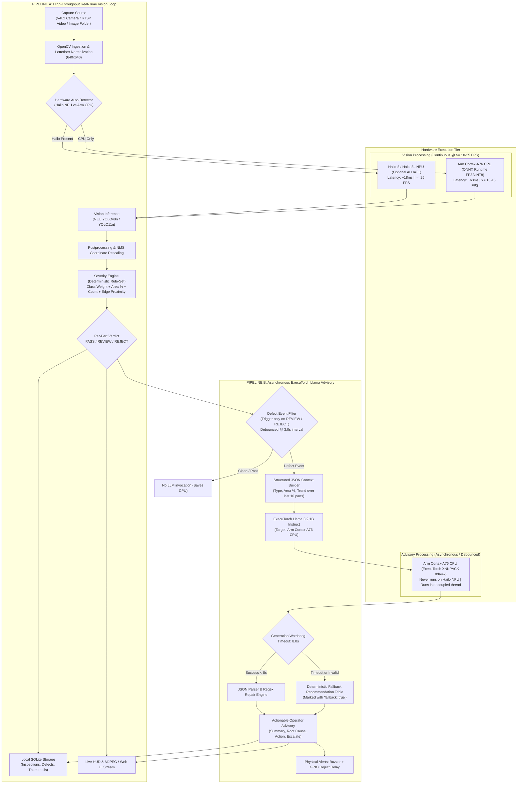

# DefectSense Edge: Architecture & Pipeline Specifications

DefectSense Edge is an on-device industrial quality-control system running completely air-gapped on edge hardware (Raspberry Pi 5 with optional Hailo-8L AI HAT+).

---

## 1. Architectural Overview & Strict Separation of Pipelines

DefectSense Edge enforces an explicit structural separation between the **real-time visual inspection loop** and the **advisory reasoning engine**.

---

## 2. Hardware Assignment Matrix

| Subsystem | Model Artifact | Compute Hardware | Runtime / Framework | Latency Target | Throughput Target |
| :--- | :--- | :--- | :--- | :--- | :--- |
| **Vision Detector** | `models/neu_yolov8n.onnx` | **Raspberry Pi 5 CPU** (4x Cortex-A76) | ONNX Runtime (CPUExecutionProvider) | ~68 ms | **>= 10 FPS** |
| **Vision Accelerator** | `models/neu_yolov8n.hef` | **Hailo-8L NPU** (PCIe AI HAT+) | HailoRT / Hailo Python SDK | ~18 ms | **>= 25 FPS** |
| **Advisory Engine** | `models/llama3_2_1b_instruct.pte` | **Raspberry Pi 5 CPU** (Cortex-A76) | **ExecuTorch (XNNPACK 8da4w)** | ~110 ms first token | Debounced async worker |
| **Decision Engine** | `config/severity_rules.yaml` | **Host CPU** | Deterministic Python Engine | < 1 ms | Instant |
| **Database & Images**| SQLite + Filesystem | Local MicroSD / NVMe SSD | SQLite3 WAL mode | < 2 ms | Synchronous write |
| **Operator UI** | Web Dashboard | Local Host (`localhost:8000`) | FastAPI + WebSocket + MJPEG | < 5 ms UI lag | Zero CDN dependencies |

> [!CAUTION]
> **No LLM on Hailo NPU:** Hailo-8 and Hailo-8L are neural accelerators dedicated to convolutional and spatial attention models. The Llama-family model executes strictly on the Arm Cortex-A76 CPU via ExecuTorch XNNPACK.

---

## 3. Severity Scoring Mathematical Formulation

The severity engine computes a deterministic score $S \in [0.0, 1.0]$:

$$S = \min\left(1.0, \, \left(w_{\text{class}} H_{\text{class}} + w_{\text{area}} F_{\text{area}} + w_{\text{count}} F_{\text{count}} + w_{\text{edge}} F_{\text{edge}}\right) \times C_{\max}\right)$$

Where:
- $w_{\text{class}} = 0.40$: Class baseline hazard weight (e.g. `crack`: 1.0, `crazing`: 0.8, `pitted_surface`: 0.7, `inclusion`: 0.6, `scratches`: 0.4).
- $w_{\text{area}} = 0.30$: Scaled surface defect area relative to part area.
- $w_{\text{count}} = 0.15$: Multi-defect penalty factor ($\min(1.0, N_{\text{defects}} / 5)$).
- $w_{\text{edge}} = 0.15$: Proximity factor if defects touch the critical 5% outer boundary edge.
- $C_{\max}$: Maximum detection confidence reported by the vision model.

### Verdict Thresholds:
- **`REJECT`**: $S \ge 0.50$ (or trigger override: any `crack` with confidence $\ge 0.45$, or total defects $> 5$).
- **`REVIEW`**: $0.25 \le S < 0.50$ (or more than 2 low-severity defects).
- **`PASS`**: $S < 0.25$ or clean part.

---

## 4. Asynchronous Queue & Non-Blocking Execution Guardrails

To prevent LLM generation from starving or lagging the camera loop:
1. **Thread Isolation**: ExecuTorch execution is encapsulated in `AsyncAdvisorWorker` running as a background daemon thread.
2. **Defect-Only Trigger**: Clean (`PASS`) parts bypass LLM processing entirely.
3. **Debounce Interval**: Configured at `3.0s`. If defective parts pass the inspection camera in rapid succession, the LLM is only prompted once per interval while intermediate parts receive instant rule-based fallback advice.
4. **Hardware Watchdog**: If generation takes longer than `timeout_seconds` (default 8.0s), the worker aborts and returns the deterministic fallback advice with `fallback_used: True`.
